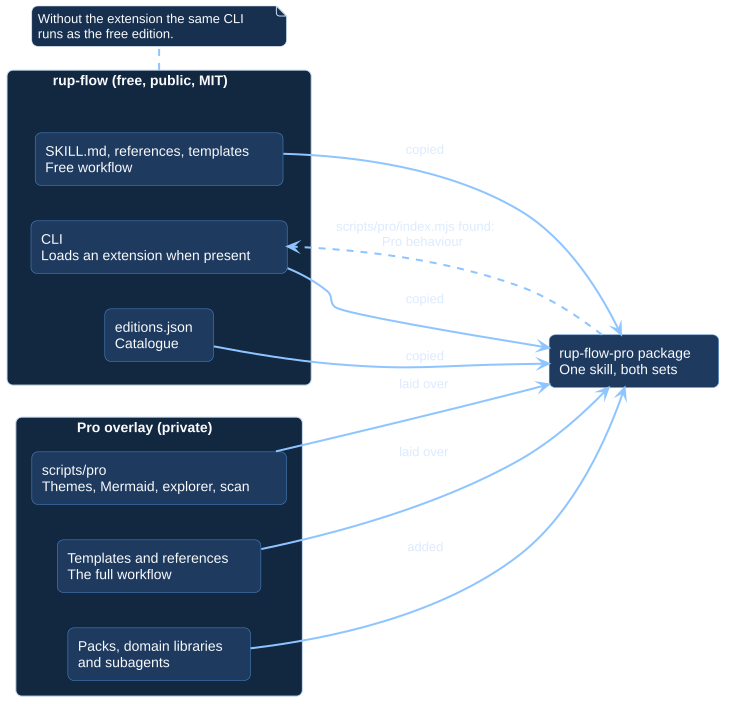

# Editions and the extension point

There is one CLI. Which edition you run depends on one file.

[Open the PlantUML source](../assets/diagrams/sources/editions-overlay.puml)

## Detection

At start, the CLI looks for `scripts/pro/index.mjs` next to itself:

| File present | Edition | Behaviour |
| --- | --- | --- |
| No | Free | Runs on its own. Anything outside the edition stops with a message that names Pro. |
| Yes | Pro | The extension adds capabilities and the CLI uses them. |

The extension is not part of this repository. It is added when the Pro package
is built.

## What the extension adds

The extension is a module that the CLI calls at defined points:

| Point | Free behaviour | With the extension |
| --- | --- | --- |
| Templates | Only the free templates exist; `init` and `new use-case` skip the rest and count them | The remaining templates are present and are written |
| Rendering | Default PlantUML look | Palettes, Mermaid, PNG previews |
| Use-case index | Table | Table and the use-case diagrams |
| Commands | Free commands | Plus `themes`, `explore`, `scan` |
| Configuration | Mermaid and non-`svg` outputs are rejected | Accepted |

## The catalogue

`editions.json` lists every diagram, document, workflow and tool with its tier.
`RUP editions` prints it and marks what is available in the installation. The
documentation pages for the catalogue are generated from the same list, so the
CLI and this site cannot disagree.

## Rules for contributors

- A capability that is not in the free edition must stop with a message that
  names Pro and exit with code `1`, or appear in the `available in Pro` line. It
  never fails silently and is never reimplemented in the free tree.
- Every new artifact gets an entry in `editions.json`.
- Validation rejects Pro templates inside the free skill.

## Why an overlay

The Pro package is the free skill with the extension laid over it, renamed
`rup-flow-pro`. Nothing is forked, so a fix in the free edition reaches both.
