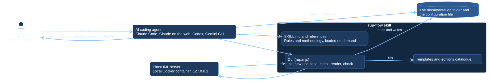

# Architecture

rup-flow is a skill plus a small command line. It has no runtime dependencies
and no service of its own.

## System context

[Open the PlantUML source](../assets/diagrams/sources/system-context.puml)

## Parts

| Part | Responsibility |
| --- | --- |
| `SKILL.md` | The operating rules and the map from a request to the reference to read |
| `references/` | Methodology, loaded on demand |
| `templates/` | Starting content of each artifact, with `{{placeholders}}` |
| `scripts/rup.mjs` | The CLI: structure, index, render, check, instructions |
| `scripts/lib/` | Small modules: PlantUML client, use-case index, instruction blocks, edition loader |
| `editions.json` | The catalogue of artifacts and capabilities, free or Pro |
| `runtime/compose.yaml` | The PlantUML container definition |
| `.claude-plugin/`, `install.mjs` | Adapters for Claude Code and for clients that read `.agents/skills` |

## Principles

- **One portable core.** The skill follows the Agent Skills format; client
  specifics live in adapters, never in the skill.
- **The agent analyses, the CLI does the boilerplate.** Structure, index,
  rendering and checks are deterministic code.
- **Honesty over completeness.** The rules forbid inventing content, and the CLI
  refuses what the edition does not include instead of faking it.
- **No dependencies.** Node.js 18 or newer is enough.

## In this section

### Editions and the extension point

How one CLI is both the free and the Pro edition.

[Read more](editions.md)

### Trust and data flow

What is read, what is written, what leaves your machine.

[Read more](trust-and-data.md)

### Delivery and branches

Releases, the plugin branch and the documentation site.

[Read more](delivery.md)

