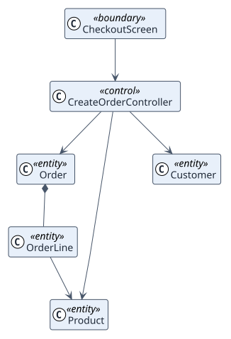

# Analysis classes

The first software structure derived from the use cases: what the user touches
(boundary), what coordinates (control) and what holds information (entity).

<div class="rup-diagram rup-diagram--light" role="region" aria-label="Scrollable UML class diagram of the analysis classes" tabindex="0" markdown>



</div>

## Source

```text
@startuml
!theme plain
hide empty members
skinparam linetype polyline
top to bottom direction

class CheckoutScreen <<boundary>>
class CreateOrderController <<control>>
class Order <<entity>>
class OrderLine <<entity>>
class Product <<entity>>
class Customer <<entity>>

CheckoutScreen --> CreateOrderController
CreateOrderController --> Order
CreateOrderController --> Product
CreateOrderController --> Customer
Order *-- OrderLine
OrderLine --> Product

@enduml
```

## Stereotypes

| Stereotype | Role |
| --- | --- |
| `<<boundary>>` | Interface between the actor and the system: a screen, an endpoint |
| `<<control>>` | Coordination of one use case |
| `<<entity>>` | Domain information, taken from the domain model |

## Conventions

- Arrows point down, from boundary to control to entity.
- One control class per use case.
- Entity names are the ones in the domain model.

<div class="rup-callout" markdown>

**Pro** adds one analysis collaboration per use case, with numbered messages,
and the analysis card that links it to the requirements and the design.

</div>
