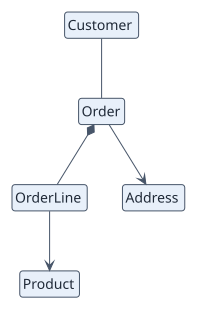

# Simplified domain model

The business concepts of the project and the relations between them. Attributes
and importance levels are left out; the entity dictionary carries the detail.

<div class="rup-diagram rup-diagram--light" role="region" aria-label="Scrollable UML class diagram of the simplified domain model" tabindex="0" markdown>



</div>

## Source

```text
@startuml
!theme plain
hide empty members
hide circle
skinparam linetype polyline
top to bottom direction

class Order
class Customer
class OrderLine
class Product
class Address

Order *-- OrderLine
Customer -- Order
OrderLine --> Product
Order --> Address

@enduml
```

## How to draw it

- File `00-domain-model/domain-model-simple.puml`.
- Entities and relations only. Choose each relation by meaning: composition only
  when the part cannot live without the whole.
- Keep it to twelve entities or fewer; split before squeezing.
- Names are the business terms recorded in the entity dictionary.

## Companion documents

`00-domain-model/README.md` holds the entity dictionary (definition, key
attributes, source) and the business rules (`RN-xxx`).

<div class="rup-callout" markdown>

**Pro** draws the same model ranked by importance, with attributes and
multiplicities, and adds the lifecycle of the entities whose state changes
behaviour. See the [catalogue](index.md).

</div>
