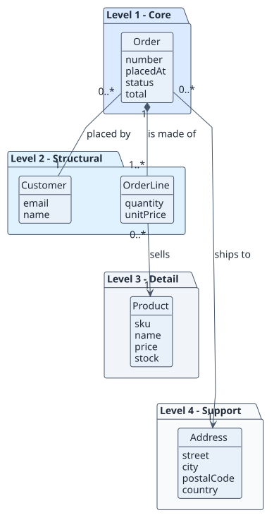
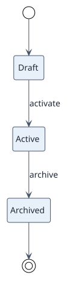
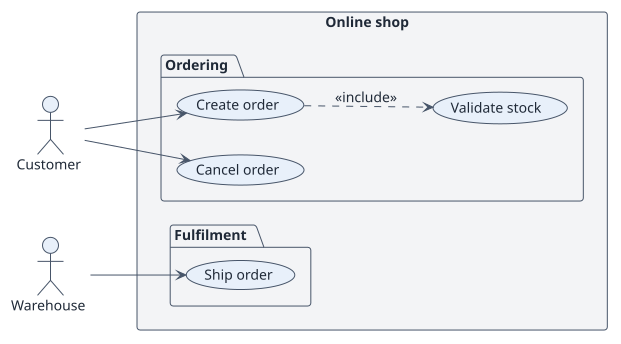
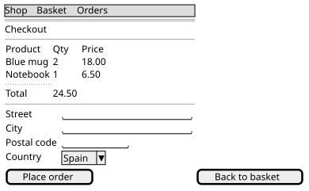
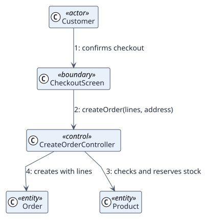
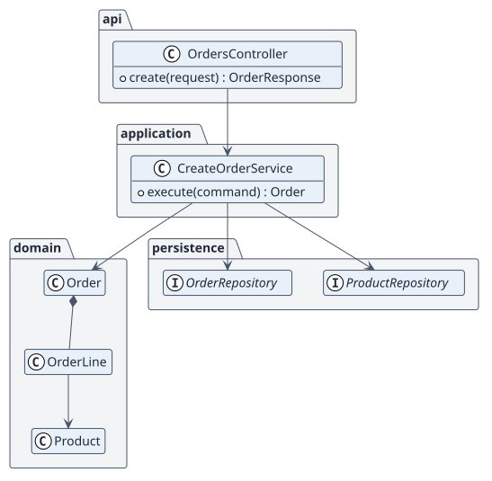
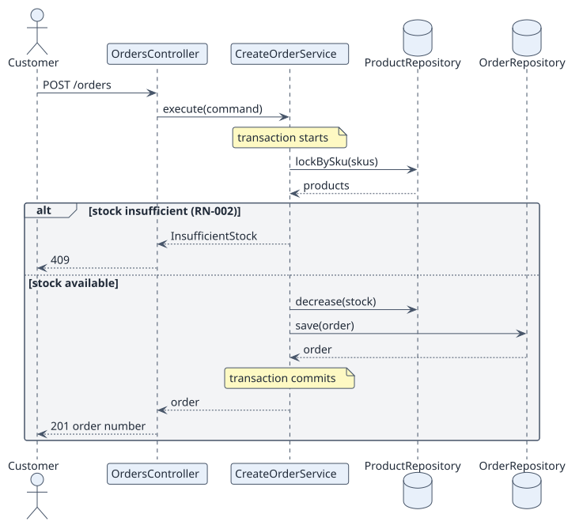
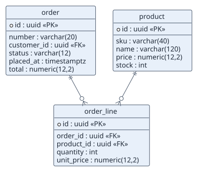
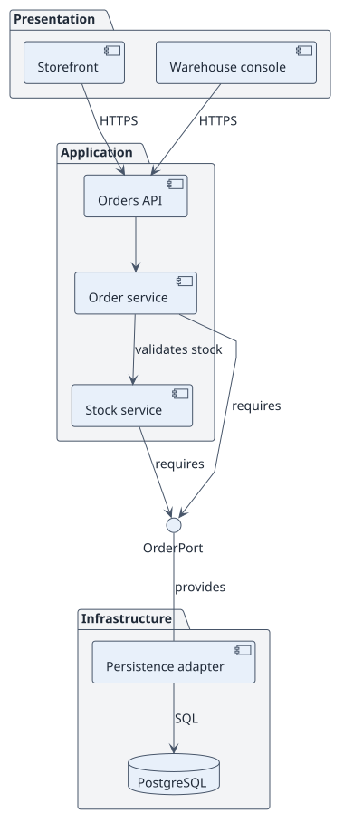
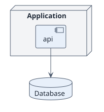

# Diagram catalogue

rup-flow draws fourteen kinds of diagram. Three are free; they cover the first
disciplines of RUP. The other eleven are part of
[rup-flow Pro](../pro/index.md). The catalogue is the same one the CLI prints
with `RUP editions`.

## Free

### Simplified domain model

Entities and relations, nothing else.

[Read more](domain-model-simple.md)

### Use-case specification

The Actor/System conversation as a statechart.

[Read more](specification.md)

### Analysis classes

Boundary, control and entity classes.

[Read more](analysis-classes.md)

## Part of Pro

Images below are rendered by the Pro edition with the default look.

<figure markdown>
{ loading=lazy }
<figcaption>Domain model ranked by importance Pro</figcaption>
</figure>

<figure markdown>
{ loading=lazy }
<figcaption>Entity lifecycles Pro</figcaption>
</figure>

<figure markdown>
{ loading=lazy }
<figcaption>Use-case diagram, general and per actor Pro</figcaption>
</figure>

<figure markdown>
{ loading=lazy }
<figcaption>Wireframes Pro</figcaption>
</figure>

<figure markdown>
{ loading=lazy }
<figcaption>Analysis collaboration Pro</figcaption>
</figure>

<figure markdown>
{ loading=lazy }
<figcaption>Design classes Pro</figcaption>
</figure>

<figure markdown>
{ loading=lazy }
<figcaption>Design sequence Pro</figcaption>
</figure>

<figure markdown>
{ loading=lazy }
<figcaption>Data model Pro</figcaption>
</figure>

<figure markdown>
{ loading=lazy }
<figcaption>Components Pro</figcaption>
</figure>

<figure markdown>
{ loading=lazy }
<figcaption>Deployment Pro</figcaption>
</figure>

All fourteen can also be drawn in Mermaid, with eight palettes or your own
colors, in Pro. See [Themes, Mermaid and the explorer](../pro/themes-and-explorer.md).
