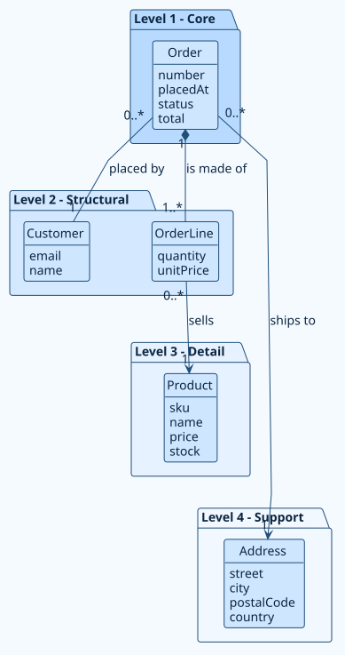
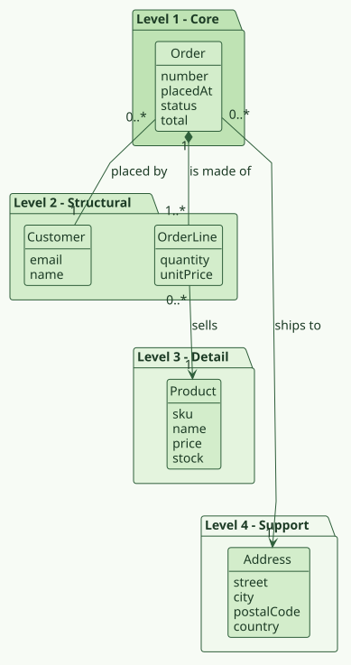
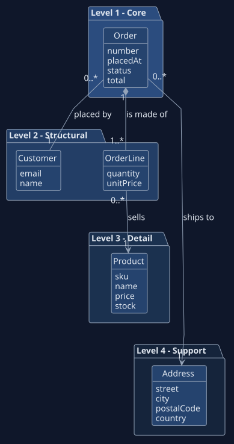
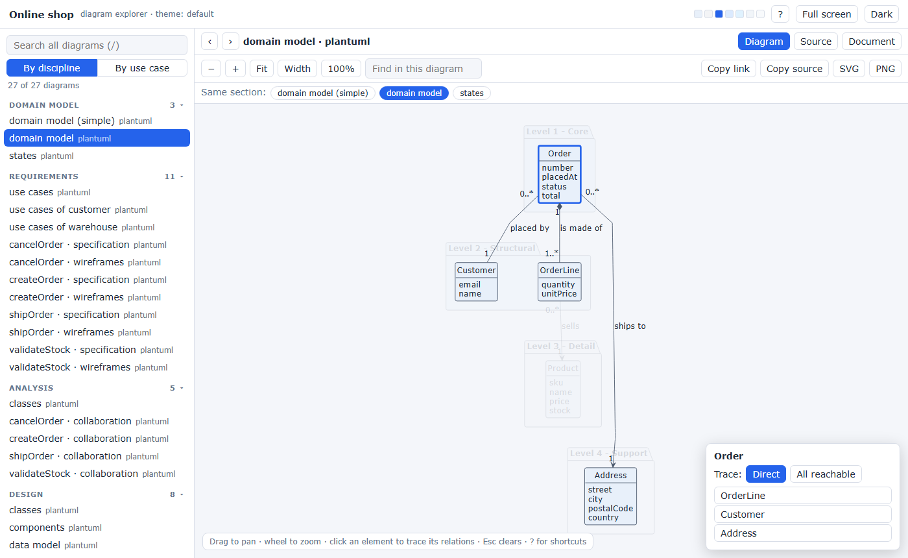

# Themes, Mermaid and the explorer

## Palettes and colors

Diagram sources never carry colors. Pro applies the look when it draws, so the
sources stay clean and one change restyles everything. You choose from eight
palettes, override single colors with your own, and set the font.

<figure markdown>
{ loading=lazy }
<figcaption>Default</figcaption>
</figure>

<figure markdown>
{ loading=lazy }
<figcaption>Ocean</figcaption>
</figure>

<figure markdown>
{ loading=lazy }
<figcaption>Forest</figcaption>
</figure>

<figure markdown>
{ loading=lazy }
<figcaption>Dark</figcaption>
</figure>

## Mermaid

Choose Mermaid instead of PlantUML as the diagram language of a project. The
same documents, the same structure and the same palettes apply.

{ loading=lazy }

## PNG previews

A raster preview next to each diagram, for tools that cannot show SVG.

## The interactive explorer

One self-contained page with every diagram of the project. Search the text of
all diagrams, select an element to highlight its relations, read the use-case
cards beside the diagrams and export what you see as PNG or SVG.

{ loading=lazy }

The explorer needs no server: it opens from the file system and loads nothing
from the network.
