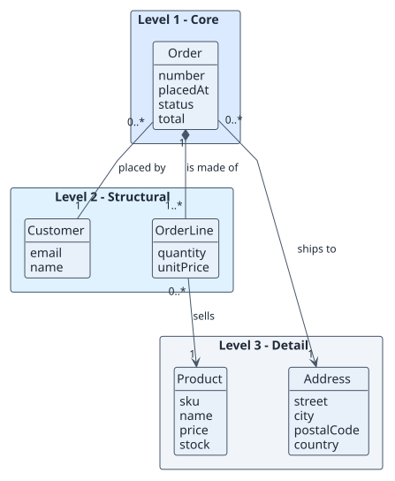
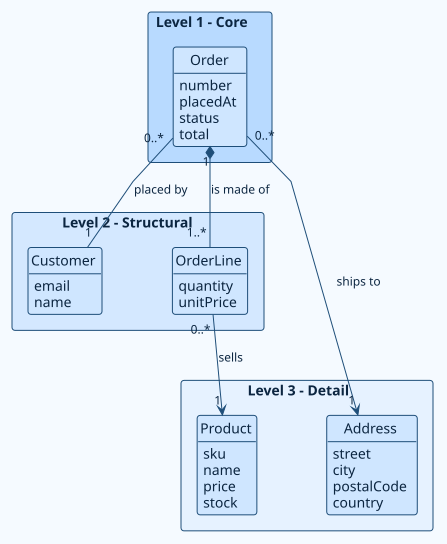
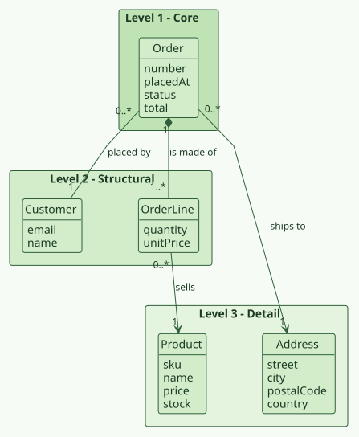
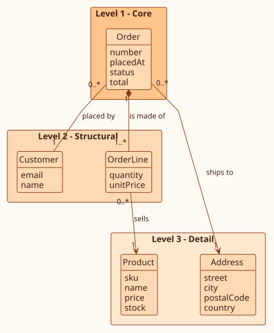
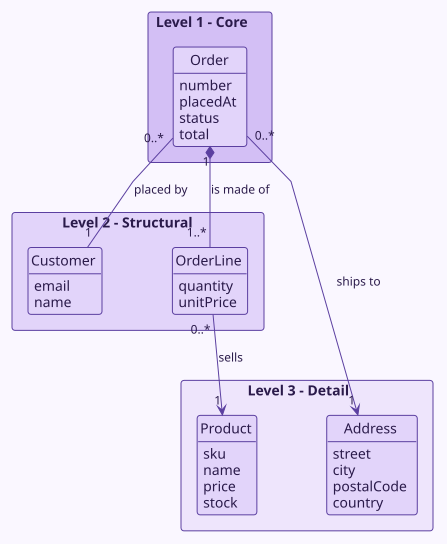
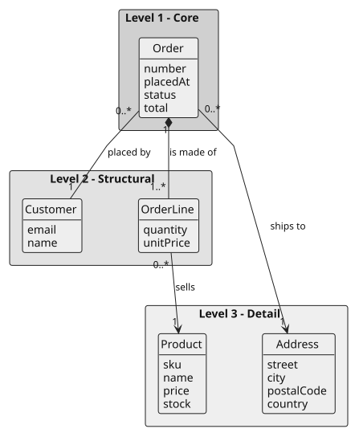
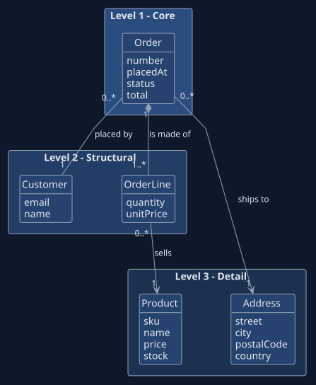
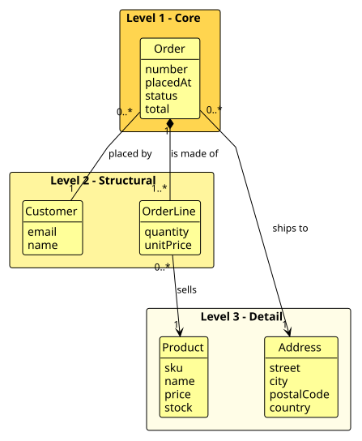

# Themes

Diagram sources never carry colors. Pro applies the look when it draws, so the sources
stay clean and one change restyles everything. Changing the palette redraws every
diagram on the next `render`.

## The palettes

| Preset | Character |
| --- | --- |
| `default` | Neutral blue-gray on white; safe for any document |
| `ocean` | Blues and teals |
| `forest` | Greens, calm and low contrast |
| `sunset` | Warm oranges and reds |
| `grape` | Purples |
| `mono` | Grayscale; prints well in black and white |
| `dark` | Dark background, light lines |
| `high-contrast` | Black on white and yellow, for accessibility |

<div class="rup-gallery" markdown>

<figure markdown>
{ loading=lazy }
<figcaption>default</figcaption>
</figure>

<figure markdown>
{ loading=lazy }
<figcaption>ocean</figcaption>
</figure>

<figure markdown>
{ loading=lazy }
<figcaption>forest</figcaption>
</figure>

<figure markdown>
{ loading=lazy }
<figcaption>sunset</figcaption>
</figure>

<figure markdown>
{ loading=lazy }
<figcaption>grape</figcaption>
</figure>

<figure markdown>
{ loading=lazy }
<figcaption>mono</figcaption>
</figure>

<figure markdown>
{ loading=lazy }
<figcaption>dark</figcaption>
</figure>

<figure markdown>
{ loading=lazy }
<figcaption>high-contrast</figcaption>
</figure>

</div>

## Choosing

```console
RUP themes
RUP render --theme ocean
```

Or in `rup.config.json`:

```json
{ "theme": { "preset": "ocean" } }
```

## Your own colors

Override single colors on top of a preset, in the configuration or with a flag:

| Color | What it paints |
| --- | --- |
| `background` | Page of the diagram |
| `text` | Text |
| `line` | Lines and arrows |
| `border` | Borders of boxes |
| `primary` | Boxes |
| `secondary` | Groups and packages |
| `accent` | Highlights |
| `note` | Notes |
| `levels` | Exactly four colors, one per domain-model level |

```json
{ "theme": { "preset": "ocean", "colors": { "accent": "#0A7A5A" } } }
```

```console
RUP render --theme ocean --color-accent "#0A7A5A"
```

Colors must be `#RRGGBB`; a wrong value or a wrong number of `levels` stops the render
with a message.

## Fonts and shape

| Setting | Flag | Default |
| --- | --- | --- |
| `theme.font` | `--font` | A sans-serif stack |
| `theme.fontSize` | `--font-size` | `14` |
| `theme.roundCorner` | none | `6` |

## Rules for sources

- Never write colors, `skinparam` color lines, init blocks or `classDef` colors into a
  diagram to style it: that overrides the palette.
- In the domain model, each level package is tagged `<<level1>>` to `<<level4>>` in
  PlantUML (`:::level1` in Mermaid) and the renderer colors it from `levels`.
- Stereotypes such as `<<boundary>>`, `<<control>>` and `<<entity>>` are content and
  stay.
- Wireframes are PlantUML salt layouts and are not themed.

## Related

[Mermaid and PNG previews](mermaid.md) · [The interactive explorer](explorer.md) ·
[Configuration](../configuration/index.md)
